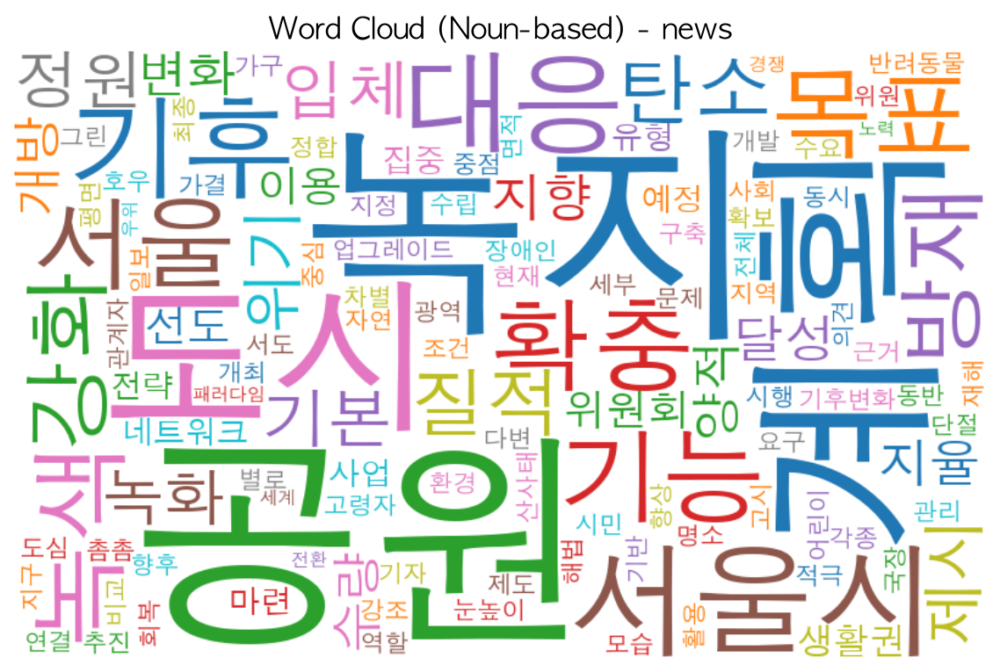
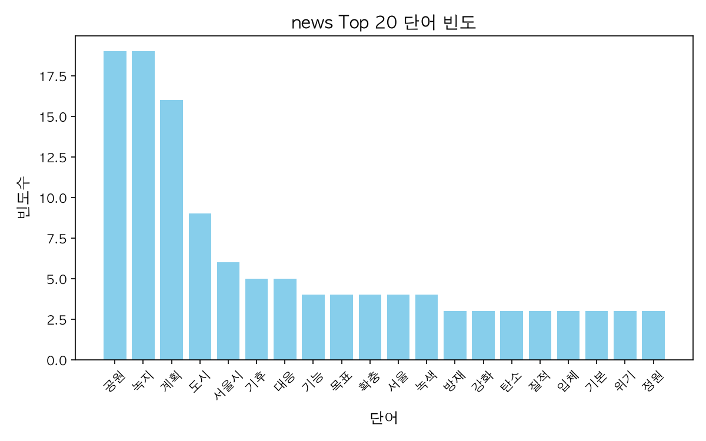

# WordCloud

Noun frequency analysis of a Korean news article (urban green space expansion for climate response), visualized as a top-20 bar chart and a word cloud.



## Problem

Week 09 homework: build a pipeline of word preprocessing → frequency analysis → visualization (bar chart + word cloud) for one Korean news article (`news.txt`), and submit a Jupyter notebook (`week09_homework.ipynb`) with the stopword list and version info at the top, together with the generated images.

## Approach

1. **Normalize** — keep only Hangul and whitespace (`[^가-힣\s]` → space), then collapse repeated spaces.
2. **Extract nouns** — KoNLPy `Okt.nouns()`; drop 1-character nouns.
3. **Remove stopwords** — 9 words unrelated to the topic: function-like nouns (`위해`, `반영`, `대해`, `이번`, `통해`, `지난`) and article metadata (`뉴시스`, reporter names `이재은`, `이수연`).
4. **Count** — `collections.Counter`, top 20 nouns.
5. **Visualize**
   - Bar chart of the top 20 nouns with title and axis labels → `output/news_top20_bar.png`
   - Word cloud from the same filtered tokens → `output/news_wordcloud.png`, with `collocations=False` so each noun is counted once instead of being split between a bigram (`공원 녹지`) and single words.

## Results

Top nouns in `news.txt` (single article; Okt, konlpy 0.6.0; after removing 1-character nouns and 9 stopwords):

| Noun | Count |
|---|---|
| 공원 (park) | 19 |
| 녹지 (green space) | 19 |
| 계획 (plan) | 16 |
| 도시 (city) | 9 |
| 서울시 (Seoul City) | 6 |

The most frequent nouns suggest the article is about the Seoul city government's plan to expand parks and green space in the city.



## Tech stack

- Python 3.11.17 on macOS 27.0.1 (arm64)
- KoNLPy 0.6.0 (Okt) + JPype1 1.7.1, OpenJDK 25
- wordcloud 1.9.6, matplotlib 3.11.2, numpy 2.4.6, pillow 13.0.0
- Font: AppleGothic (macOS)

## Run

KoNLPy needs a Java runtime (JDK) on the machine.

`news.txt` is not included in this repository (the article is copyrighted by Newsis). Save the article text from the [source link](https://www.newsis.com/view/NISX20250205_0003054569) as `news.txt` (UTF-8) in the project root before running.

```bash
python3 -m venv .venv
.venv/bin/pip install konlpy==0.6.0 wordcloud==1.9.6 matplotlib==3.11.2
.venv/bin/python main.py   # saves both charts to output/
```

The notebook is generated from `main.py` (`# %%` cell markers) with jupytext:

```bash
.venv/bin/pip install jupytext
.venv/bin/jupytext --to notebook main.py -o week09_homework.ipynb
```

On Windows, change the font settings at the top of `main.py` (e.g. `Malgun Gothic` / `C:/Windows/Fonts/malgun.ttf`).

## Lessons learned

- Broken Hangul (□) in matplotlib was a font issue, not an encoding issue: `Malgun Gothic` exists only on Windows. matplotlib needs a font name (`font.family`), while WordCloud needs a font file path (`font_path`); on this Mac, AppleGothic is under `/System/Library/Fonts/Supplemental/`.
- WordCloud's default `collocations=True` turned a frequent noun pair into a bigram, so the same words appeared twice and the cloud no longer matched the bar chart.
- `__file__` is not defined in Jupyter, so the output folder uses a path relative to the working directory.
- jupytext converts commented shell commands (`# !apt-get ...`) into executable notebook magics, which broke a comment block with an `IndentationError`.

## References

- Source article (Newsis, Korean; text analyzed as `news.txt`): https://www.newsis.com/view/NISX20250205_0003054569
